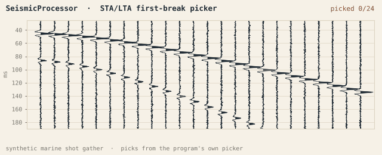
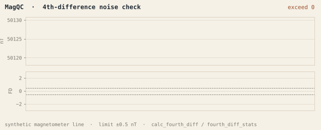
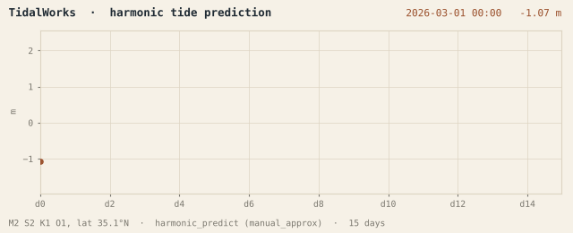

## Junhyub Kim · 김준협

Marine geophysical surveyor at GeoView, Busan.
I write the in-house software we use to QC, process and deliver survey data.

geohyub@gmail.com · [GeoView version index](https://github.com/geohyub/geoview-updates)

---

<picture>
  <source media="(prefers-color-scheme: dark)" srcset="assets/seismic-firstbreak-dark.gif">
  
</picture>

<table>
<tr>
<td width="50%">
<picture>
  <source media="(prefers-color-scheme: dark)" srcset="assets/magqc-fourthdiff-dark.gif">
  
</picture>
</td>
<td width="50%">
<picture>
  <source media="(prefers-color-scheme: dark)" srcset="assets/tidalworks-tide-dark.gif">
  
</picture>
</td>
</tr>
</table>

Synthetic data run through the programs' own code: SeismicProcessor's STA/LTA picker,
MagQC's <code>calc_fourth_diff</code>, TidalWorks' <code>harmonic_predict</code>.
Generated by <a href="assets/make_gifs.py">assets/make_gifs.py</a>.

### GeoView

Desktop tools for marine survey data: magnetometer, multibeam, side-scan sonar,
SBP / UHR seismic, navigation, tide and geotechnical.
41 programs are listed in the release index. Mostly Python and PySide6,
with a few TypeScript and .NET apps. The source is private.

| Stage | Programs |
|---|---|
| Prepare | MagPrep · OffsetManager · CalibrationPro · DataForge · SyncChecker · NamingChecker |
| QC | QCHub · MagQC · MBESQC · SeismicQC · SonarQC · NavQC · SGYCompare |
| Process | MagProc · SeismicProcessor · TidalWorks · TideBedPy · P190NavConverter · CoordConverter · Feathering |
| Deliver | HandoverGenerator · DeliveryBinder · ReportDraft · DailyReport · DocTemplates · CommentTracker |
| Operate | ControlTower · LaunchPad · LineTracker · ProjectManager · PValue · StorageManager |
| Research | MarineSeismicAI (first-break picking) · SeismicDenoising · VelocityPicking |

### Stack

Python · PySide6 · Flask · FastAPI · NumPy / SciPy · segyio · pyproj · PyTorch ·
TypeScript · Next.js · Tauri · .NET

### Design

Light theme, paper-cream background, hairline structure, no decoration.
Data density as precision. Typography as hierarchy.
A QC result that was not checked is shown as not checked, never as a pass.
