## Junhyub Kim · 김준협

Marine geophysical surveyor at GeoView, Busan.
I write the in-house software we use to QC, process and deliver survey data.

geohyub@gmail.com · [GeoView version index](https://github.com/geohyub/geoview-updates)

---

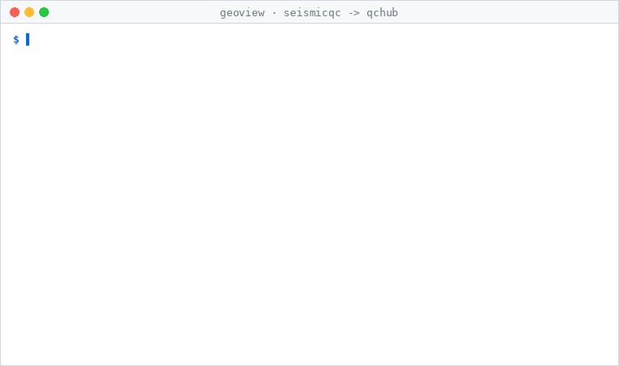

A real run, recorded from its own output: the SeismicQC headless CLI grades three synthetic
UHR lines (one deliberately truncated, which the SEG-Y header check fails), writes
<code>geoview.qc-result/1</code> files, and QCHub imports them through its API into per-line status.
Re-importing a file updates the row instead of duplicating it.
Rendered by <a href="assets/make_pipeline_gif.py">assets/make_pipeline_gif.py</a>.

<table>
<tr>
<td width="50%">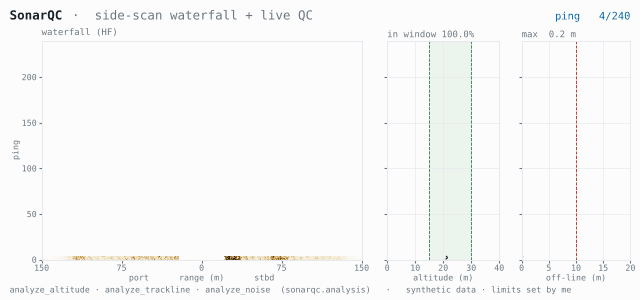</td>
<td width="50%">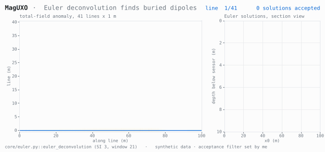</td>
</tr>
<tr>
<td width="50%">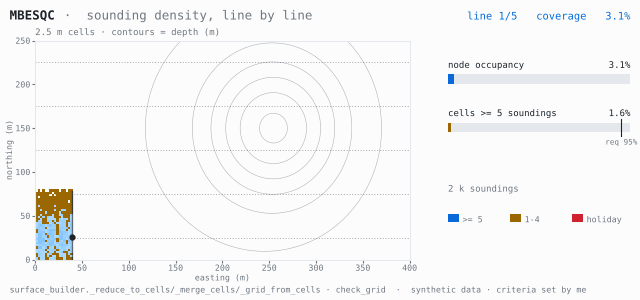</td>
<td width="50%">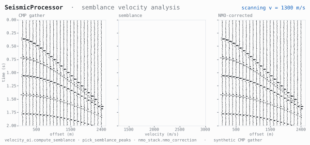</td>
</tr>
<tr>
<td width="50%">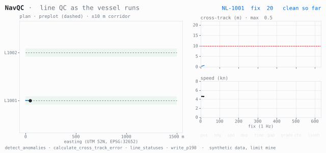</td>
<td width="50%">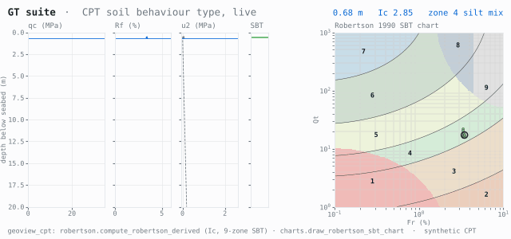</td>
</tr>
</table>

Side-scan QC, magnetic target detection, multibeam density, seismic velocity analysis, navigation QC and CPT classification,
each driven by the program's own functions (named under each panel) on synthetic data.
QC limits in these demos are illustrative. Rendered by <a href="assets/make_visuals.py">assets/make_visuals.py</a>
and <a href="assets/make_visuals_2.py">assets/make_visuals_2.py</a>.

#### More of the programs

<table>
<tr>
<td width="50%">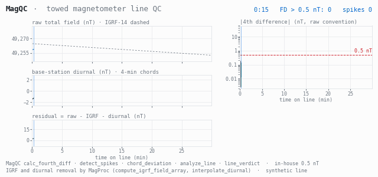</td>
<td width="50%">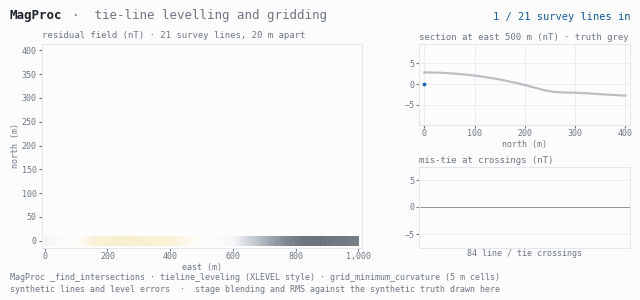</td>
</tr>
<tr>
<td width="50%">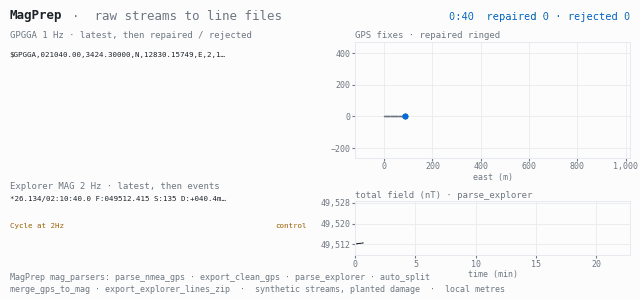</td>
<td width="50%">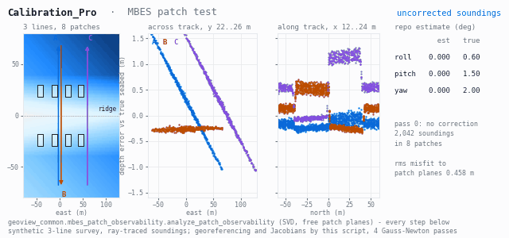</td>
</tr>
<tr>
<td width="50%">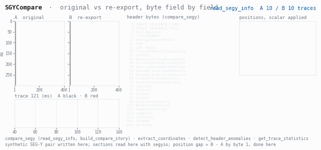</td>
<td width="50%">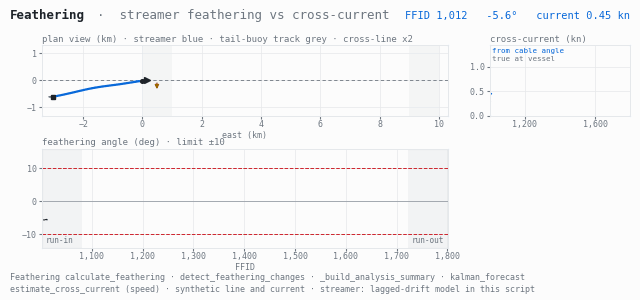</td>
</tr>
<tr>
<td width="50%">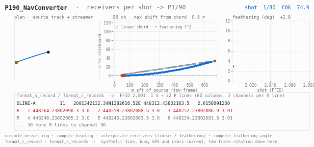</td>
<td width="50%">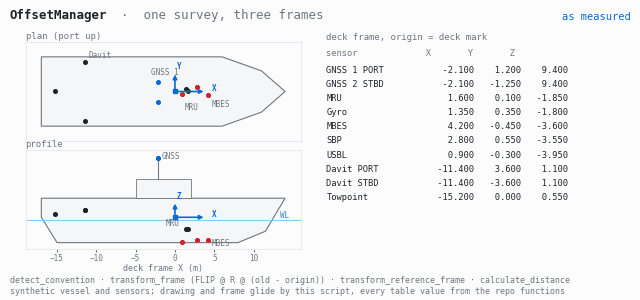</td>
</tr>
<tr>
<td width="50%">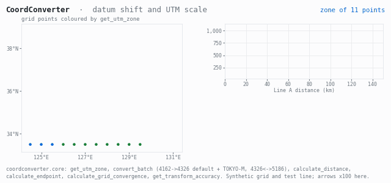</td>
<td width="50%">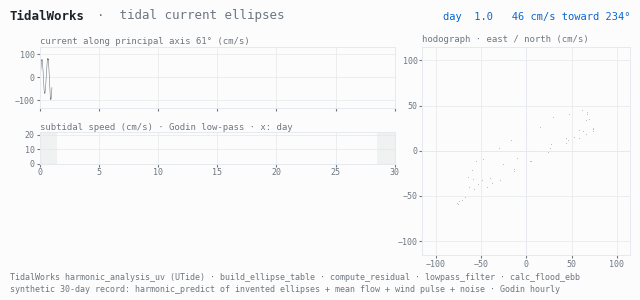</td>
</tr>
<tr>
<td width="50%">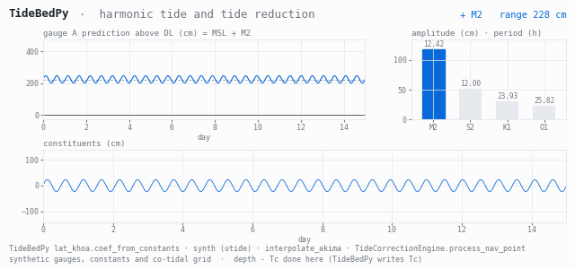</td>
<td width="50%">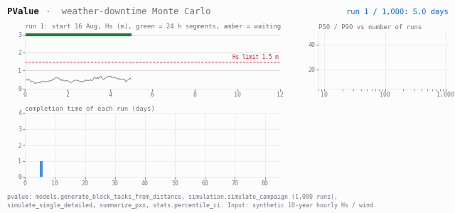</td>
</tr>
<tr>
<td width="50%">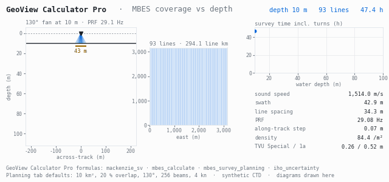</td>
<td width="50%"></td>
</tr>
</table>

Same approach: each panel is computed by the named program functions on synthetic input, and anything the
generator does itself is stated in the footer. QC limits are the programs' own defaults unless noted.
Rendered by <a href="assets/make_magqc_tide_gif.py">make_magqc_tide_gif.py</a>, <a href="assets/make_mag2_gif.py">make_mag2_gif.py</a>,
<a href="assets/make_calib_offset_gif.py">make_calib_offset_gif.py</a>, <a href="assets/make_seis2_gif.py">make_seis2_gif.py</a>,
<a href="assets/make_feather_tidal_gif.py">make_feather_tidal_gif.py</a>, <a href="assets/make_coord_pvalue_gif.py">make_coord_pvalue_gif.py</a>
and <a href="assets/make_calc_trainer_gif.py">make_calc_trainer_gif.py</a>.

#### Machine learning

<table>
<tr>
<td width="50%">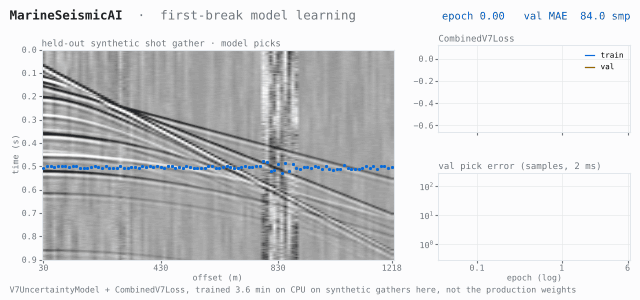</td>
<td width="50%">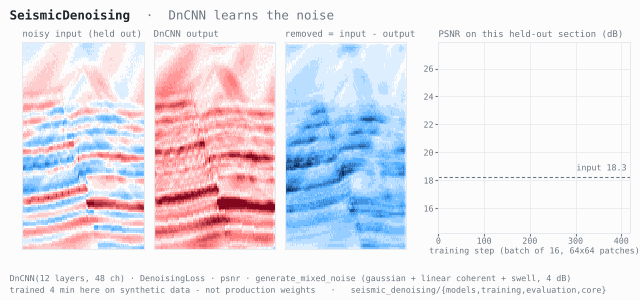</td>
</tr>
<tr>
<td width="50%">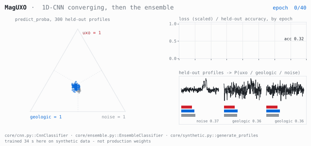</td>
<td width="50%">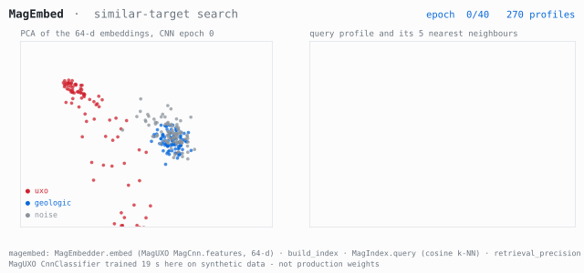</td>
</tr>
<tr>
<td width="50%">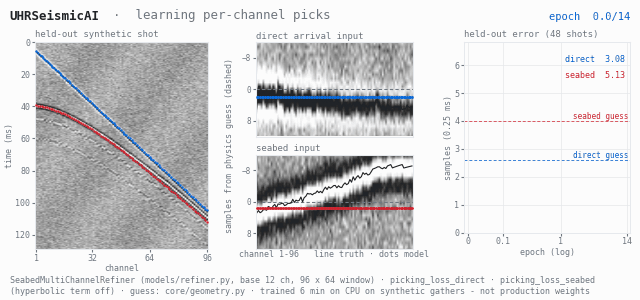</td>
<td width="50%">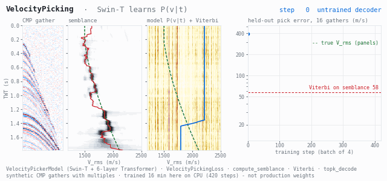</td>
</tr>
<tr>
<td width="50%">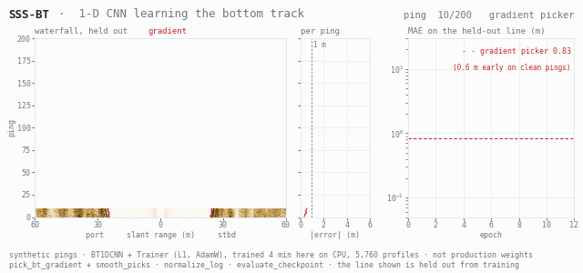</td>
<td width="50%"></td>
</tr>
</table>

Each model is the repo's own class, trained here for seconds to minutes on synthetic data
(not the production weights): MarineSeismicAI <code>V7UncertaintyModel</code> with MC-Dropout flags,
SeismicDenoising <code>DnCNN</code>, MagUXO <code>CnnClassifier</code> + <code>EnsembleClassifier</code>,
and MagEmbed cosine k-NN search over MagUXO CNN features (example queries),
UHRSeismicAI <code>SeabedMultiChannelRefiner</code>, VelocityPicking <code>VelocityPickerModel</code> (Swin-T)
and SSSBTPicker <code>BT1DCNN</code> through the repo's own <code>Trainer</code>.
Rendered by <a href="assets/make_visuals_2.py">make_visuals_2.py</a>, <a href="assets/make_visuals_ml.py">make_visuals_ml.py</a>,
<a href="assets/make_uhr_gif.py">make_uhr_gif.py</a>, <a href="assets/make_velocity_gif.py">make_velocity_gif.py</a>
and <a href="assets/make_sssbt_gif.py">make_sssbt_gif.py</a>.

### GeoView

In-house tools for offshore survey work, from the vessel to the client delivery.
41 programs are in the release index; most are Python / PySide6 desktop apps,
some are web apps (Flask, FastAPI, Next.js) and a few are .NET. The source is private.

How they fit together: raw files are prepared and checked on board,
each QC app grades every line and writes a common result file,
QCHub and LineTracker collect those into project and line status,
and HandoverGenerator checks the delivery package before it leaves.

### By discipline

**Magnetics**
| Program | What it does |
|---|---|
| MagPrep | Preprocesses raw magnetometer files before QC |
| MagQC | Line QC: 4th-difference noise, contract (SoW) verdict per line, reports |
| MagProc | 8-stage processing pipeline with IGRF reference field removal |
| MagUXO | UXO target detection: Euler deconvolution plus a CNN ensemble |

**Multibeam and hydrography**
| Program | What it does |
|---|---|
| MBESQC | Multibeam QC: motion, offsets, SVP, density and coverage, DQR reports |
| CATZOCAssigner | Assigns CATZOC zone-of-confidence categories |
| SVPBatchViewer | Batch viewer for sound velocity profiles |
| MBESPerfExport | Exports multibeam performance metrics |
| FusionGrid | Fuses QC grids from several sources |

**Side-scan sonar**
| Program | What it does |
|---|---|
| SonarQC | Side-scan QC per line: altitude, track, position and noise stages |
| MosaicEye | Visual QC of sonar mosaics |
| SSSBTPicker | Side-scan bottom-tracking picker |

**Seismic (SBP / UHR)**
| Program | What it does |
|---|---|
| SeismicQC | SEG-Y QC: seafloor, navigation, SNR, bandwidth, dead traces, header checks |
| SeismicProcessor | Processing engine: geometry from navigation, velocity analysis, QC decks, daily reports |
| SGYCompare | Trace-level comparison of two SEG-Y files |
| segylint | SEG-Y rev1/rev2 spec linter with SARIF output for CI |
| Feathering | Streamer feathering analysis |

**Navigation, positioning and calibration**
| Program | What it does |
|---|---|
| NavQC | Navigation QC and P-format export (P1/90, P1/11, P2/94, P2/11) |
| P190NavConverter | Converts navigation to and from P1/90 |
| CoordConverter | 13 coordinate transformations: UTM, DMS, MGRS, P190, GeoJSON |
| OffsetManager | Vessel sensor offsets with 22 validation rules |
| CalibrationPro | Sensor calibration QC and certificates: GNSS, MAG altimeter, SVP, heading |

**Tide, current and metocean**
| Program | What it does |
|---|---|
| TidalWorks | Tidal and current harmonic analysis (UTide), reports |
| TideGuard | Validates tide data before it is applied |
| PValue | Weather-window (P-value) simulator for planning offshore operations |

**Geotechnical**
| Program | What it does |
|---|---|
| GTPrep · GTProc · GTQC | CPT / SPT / laboratory data: preparation, processing and QC |

**Delivery and reporting**
| Program | What it does |
|---|---|
| HandoverGenerator | Builds and validates the delivery package; blocks leaked local paths |
| DeliveryBinder | Binds delivery documents |
| DeliveryGuard | Checks delivered PDFs for redaction and watermark problems |
| ReportDraft · DailyReport · DocTemplates | Report drafting, daily reports, document templates |
| CommentTracker | Tracks client review comments and responses |

**Operations on board and in the office**
| Program | What it does |
|---|---|
| QCHub | Project QC hub: checklists, issues, imported QC results per line |
| LineTracker | Survey line status across the project |
| DataFerry | Distributes acquisition data from the vessel automatically |
| SyncChecker · NamingChecker | Verifies NAS copies and file naming rules |
| StorageManager · ArchiveManager | Storage audit (.NET) and project archiving |
| ControlTower · LaunchPad | Operations dashboard (Next.js) and launcher for the suite |
| ProjectManager · ProcessWorkflow | Project milestones and the process / task workflow |
| EquipMan | Equipment register with QR labels and certificates |
| WiringGen | Survey wiring diagram generator (DXF) |
| CalculatorPro | Survey calculators: seismic fold, resolution, NMO and more |
| PortDetector | Network and device monitor |

**Applied AI and research**
| Program | What it does |
|---|---|
| MarineSeismicAI | First-break picking ensemble with MC-Dropout uncertainty (PyTorch) |
| SeismicDenoising | DnCNN / Swin denoising for marine seismic |
| VelocityPicking | Machine-learning velocity picking |
| sbp-kit | SBP / UHR toolkit: robust SEG-Y I/O, self-supervised denoising |
| ReportLLM | Local-LLM report drafting with a guard on every number |
| QCMemory · VisionNarrator | QC case retrieval, and local vision-LLM QC comments |

### Stack

Python · PySide6 · Flask · FastAPI · NumPy / SciPy · segyio · pyproj · PyTorch ·
TypeScript · Next.js · Tauri · C# / .NET · GitHub Actions
