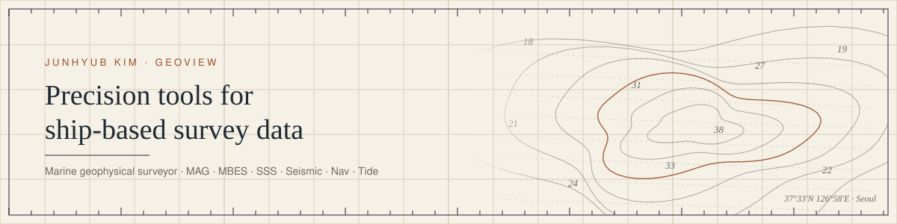

<picture>
  <source media="(prefers-color-scheme: dark)" srcset="assets/header-dark.svg">
  
</picture>

<div align="center">

**Marine geophysical surveyor who writes the software the survey runs on.**

[Email](mailto:geohyub@gmail.com) · [GeoView version index](https://github.com/geohyub/geoview-updates)

</div>

---

### GeoView

An in-house desktop suite for marine survey work, built on board and in the office.
It covers the whole chain from raw sensor files to the client delivery package:
magnetometer, multibeam echosounder, side-scan sonar, seismic (SBP/UHR), navigation,
tide, and geotechnical data.

| | |
|---|---|
| **41** programs in the release index | **6** survey disciplines, one workflow |
| **1.3M+** lines of Python in the core apps | Automated tests on every core app |

One rule runs through all of it: **quiet precision over loud features.**
A QC tool that reports a pass it never actually checked is worse than having no tool.
So the apps say what they could not check, show the number behind every verdict,
and never write an absolute path into a delivered file.

### The chain

```
  prepare ──────► QC ──────────► process ─────────► deliver ─────────► operate
  MagPrep         QCHub          MagProc            HandoverGenerator   ControlTower
  OffsetManager   MagQC          SeismicProcessor   DeliveryBinder      LaunchPad
  CalibrationPro  MBESQC         TidalWorks         ReportDraft         LineTracker
  DataForge       SeismicQC      TideBedPy          DailyReport         ProjectManager
  SyncChecker     SonarQC        P190NavConverter   DocTemplates        PValue
  NamingChecker   NavQC          CoordConverter     CommentTracker      StorageManager
                  SGYCompare     Feathering
```

<details>
<summary><b>What each one does</b></summary>

<br>

**Quality control**

| Program | What it does |
|---|---|
| **QCHub** | One hub for the QC apps: project checklists, issue tracking, line status |
| **MBESQC** | Multibeam QC with 9-module weighted scoring |
| **MagQC** | Marine magnetometer QC analysis and reporting |
| **SeismicQC** | SEG-Y QC: 10-stage pipeline with grading |
| **SonarQC** | Side-scan sonar QC |
| **NavQC** | Navigation QC and P-format export (P1/90, P1/11, P2/94, P2/11) |
| **SGYCompare** | Trace-level SEG-Y comparison |
| **segylint** | SEG-Y rev1/rev2 spec linter with SARIF output for CI |

**Processing**

| Program | What it does |
|---|---|
| **SeismicProcessor** | Seismic processing engine: geometry, velocity analysis, QC decks |
| **MagProc** | 8-stage magnetometer processing with IGRF-13 |
| **TidalWorks** | Tidal and current harmonic analysis (UTide) |
| **TideBedPy** | Tidal correction utility |
| **P190NavConverter** | P1/90 navigation conversion |
| **CoordConverter** | 13 coordinate transformations: UTM, DMS, MGRS, P190, GeoJSON |
| **Feathering** | Streamer feathering analysis |

**Preparation, calibration, delivery**

| Program | What it does |
|---|---|
| **CalibrationPro** | Sensor calibration QC workspace with certificates |
| **OffsetManager** | Vessel sensor offset workflows |
| **MagPrep** | Magnetometer preprocessing |
| **HandoverGenerator** | Delivery package assembly and validation |
| **DeliveryGuard** | Delivery check for leaked absolute paths and missing watermarks |

**Applied AI**

| Program | What it does |
|---|---|
| **MarineSeismicAI** | First-break picking ensemble with MC-Dropout uncertainty (PyTorch) |
| **SeismicDenoising** | DnCNN / Swin denoising research pipeline |
| **VelocityPicking** | ML velocity picking |

**Operations**

| Program | What it does |
|---|---|
| **ControlTower** | Operations dashboard for the whole suite |
| **LaunchPad** | Launcher and workflow hub |
| **PValue** | Weather-window (P-value) simulator for marine operations |
| **LineTracker** | Survey line status |

</details>

### Stack

`Python` · `PySide6` · `Flask` · `FastAPI` · `NumPy / SciPy` · `segyio` · `pyproj` · `PyTorch`
`TypeScript` · `Next.js` · `Tauri` · `.NET` · `GitHub Actions`

### Design: Quiet Paper

> Light theme on a paper-cream background, hairline structure, no decoration.
> Data density is the precision. Typography carries the hierarchy. Heritage without costume.
>
> Drawn from British Admiralty charts, and from modern tools like Linear, Stripe and Raycast.

---

<sub>The source is private. Release notes and current versions are public in
<a href="https://github.com/geohyub/geoview-updates">geoview-updates</a>.
Built quietly in Seoul · <a href="mailto:geohyub@gmail.com">geohyub@gmail.com</a></sub>
